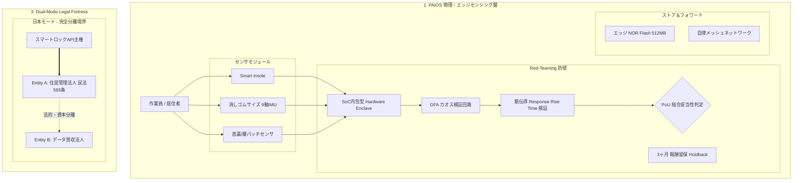
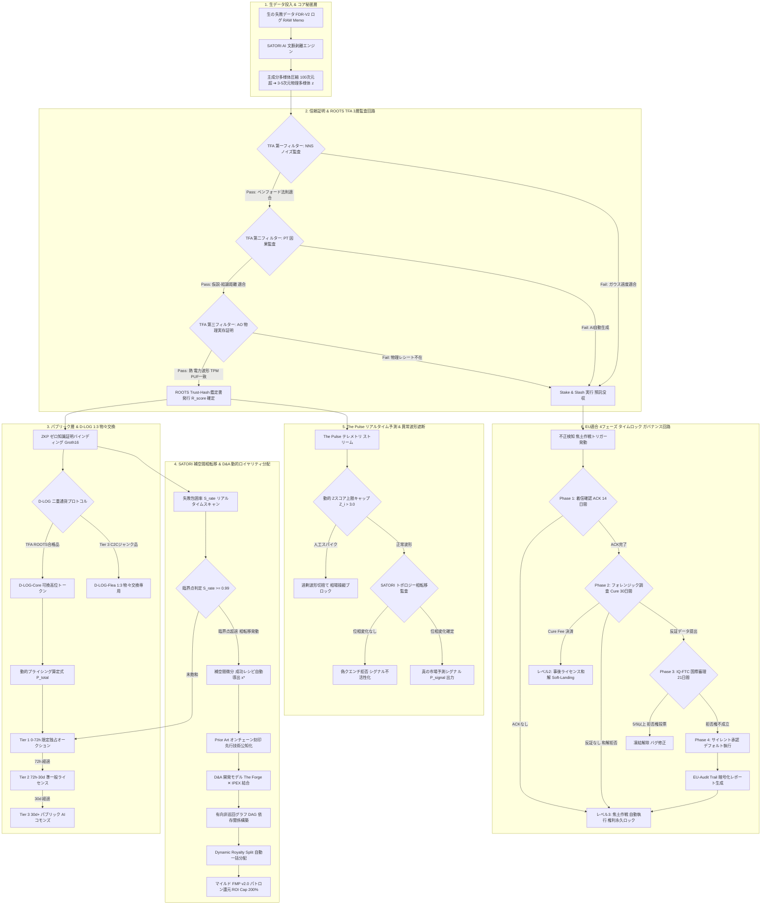

# Project SOMA × The Forge

[English](#english) | [日本語](#japanese)

---

## ── English Overview

> **Autonomous Physical-Sensing Infrastructure & Negative-IP Liquidation Engine**
> A unified, self-sovereign systemic framework combining edge physical sensing, a dual-mode legal fortress, and a negative-IP clearance protocol.

### Architecture Highlights
- **Project SOMA (Physical-AI OS):** Zero-touch physical data mining, DFA chaos verification, and dual-mode legal boundaries (Japan Civil Code Art. 593 / US 1099-NEC).
- **The Forge:** Clearance protocol for negative IP (failed research logs), topological state transition (SATORI Engine), zero-knowledge proof binding, and dynamic royalty distribution (D&A Model).

---

### System Architecture Diagrams

#### 1. Project SOMA Topology

#### 2. The Forge Pipeline

---

### Repository Navigation (Documents)

| Category | Japanese (日本語) | English (英語) |
|---|---|---|
| **SOMA Specification** | [SOMA_WHITEPAPER_JP.md](./SOMA_WHITEPAPER_JP.md) | [SOMA_WHITEPAPER_EN.md](./SOMA_WHITEPAPER_EN.md) |
| **The Forge Specification** | [FORGE_WHITEPAPER_JP.md](./FORGE_WHITEPAPER_JP.md) | [FORGE_WHITEPAPER_EN.md](./FORGE_WHITEPAPER_EN.md) |
| **SOMA Audit Issues** | [SOMA_ISSUES_JP.md](./SOMA_ISSUES_JP.md) | [SOMA_ISSUES_EN.md](./SOMA_ISSUES_EN.md) |
| **The Forge Audit Issues** | [FORGE_ISSUES_JP.md](./FORGE_ISSUES_JP.md) | [FORGE_ISSUES_EN.md](./FORGE_ISSUES_EN.md) |
| **Architect Manifesto** | [ARCHITECT_NOTES.md](./ARCHITECT_NOTES.md) | [ARCHITECT_NOTES.md](./ARCHITECT_NOTES.md) |
| **Disclaimer & License** | [DISCLAIMER.md](./DISCLAIMER.md) | [DISCLAIMER.md](./DISCLAIMER.md) |

---

## ── 日本語概要

本プロジェクトは、人間の悪意や制度のバグを前提とし、物理・金融・法務の3レイヤーで防腐化された自律型社会インフラ・システムです。

- **Project SOMA:** 物理行動データ採掘（PAIOS）および民法593条（使用貸借）等による法的実効境界。
- **The Forge:** 失敗データ（負の知財）のSATORI相転移および暗号学的動的ロイヤリティ分配エンジン。

詳細は上記のドキュメント目次より各仕様書・課題リストを参照してください。

---

## ── Maintenance & Response Protocol (連絡・応答方針)

### English
- **Communication Style:** Asynchronous & Irregular.
- **Availability:** Responses to Issues, Discussions, and Pull Requests are handled on an irregular basis (primarily during weekends) depending on capacity. 
- **Policy:** Urgent demands or sentimental pressure will be ignored. Contributions and critical technical feedback are always reviewed asynchronously when bandwidth permits.

### 日本語
- **通信スタイル:** 完全非同期・不定期応答。
- **稼働状態:** Issue、Discussion、Pull Request への確認・返信は、本業およびプライベートの合間（主に週末）に不定期で行われます。
- **方針:** 返信の催促や情緒的な要求には対応しません。提案や技術的フィードバックは、リソースが確保できたタイミングで非同期に確認します。

---

## ── License & Disclaimer
- **License:** MIT License
- **Disclaimer:** See [DISCLAIMER.md](./DISCLAIMER.md) for research & legal disclaimers.